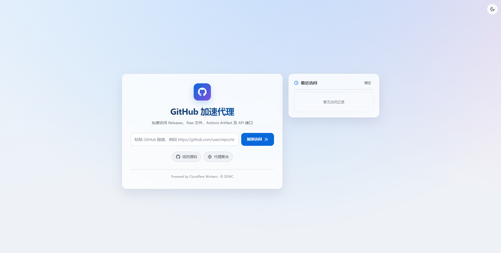
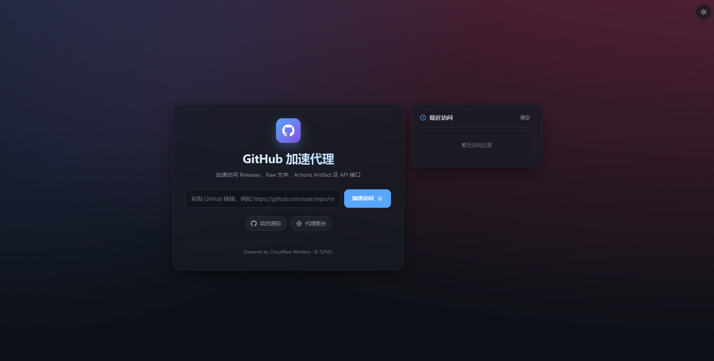

# CF-GH-Proxy
本项目是一个基于 Cloudflare Workers 的 Github 镜像代理工具。它能够中转 Github 项目请求，解决一些访问限制和加速访问的问题。

## 参考图(开关夜间模式）

## Workers 部署方法
### 部署 Cloudflare Worker：

   - 在 Cloudflare Worker 控制台中创建一个新的 Worker。
   - 将 [worker.js](./worker.js) 的内容粘贴到 Worker 编辑器中。

## 缓存与限流

- `api.github.com` 的 JSON 响应不再写入边缘长缓存，始终回源并带 `Cache-Control: no-store`，避免拿到过期的 Star 数、Release 列表等数据。
- 其他 GitHub 静态资源仍按原策略缓存。
- Artifact 元数据会缓存一小段时间（匿名 5 分钟、带 Token 1 分钟），以减少 GitHub API 的调用次数；带 Token 与匿名的缓存互不共用。
- 未配置 `GITHUB_TOKEN` 时，GitHub 对同一出口 IP 的匿名 API 额度是 60 次/小时。额度耗尽会返回带重置时间的提示，此时在 Worker 上配置 Secret 即可恢复。
- 代理请求中，`Authorization` 头只会转发给 `api.github.com`；其他目标（包括 GitHub 的 CDN）会移除该头。
- 支持 `release-assets.githubusercontent.com`、`github-releases.githubusercontent.com` 等 GitHub Release 下载直链（它们此前不在允许列表里，粘贴直链会 404）。

## Actions Artifact 下载

GitHub 现已强制要求认证才能下载 Actions Artifact，匿名访问只会拿到登录跳转。本代理支持三种方式：

1. **Worker Secret（推荐给站点管理员）**：在 Cloudflare Worker 设置中添加 Secret `GITHUB_TOKEN`，建议使用 fine-grained Token 并只勾选目标仓库的 `Actions: Read`。配置后公开/私有仓库的 Artifact 都可直接下载，用户无需输入。
2. **请求头**：`Authorization: Bearer <token>` 或 `x-github-token: <token>`。
3. **URL 参数**：`?token=<token>`。注意这会出现在访问日志里，建议优先用请求头。

直接用浏览器打开 Artifact 链接时，若没有可用 Token，会显示一个带 Token 输入框的提示页，填写后即可下载；脚本访问（非 `text/html`）则返回 `401` JSON 和 `WWW-Authenticate: Bearer`。

支持以下链接形式：

- `https://github.com/{owner}/{repo}/actions/runs/{run_id}/artifacts/{artifact_id}`
- `https://github.com/{owner}/{repo}/suites/{suite_id}/artifacts/{artifact_id}`
- `https://api.github.com/repos/{owner}/{repo}/actions/artifacts/{artifact_id}` 及其 `/zip` 地址

响应会带上真实的 `Content-Disposition` 文件名、`x-artifact-name`、`x-artifact-digest`，并设置 `Cache-Control: no-store`（Artifact 不缓存）。已过期的 Artifact 返回 `410`。

> 说明：Token 只会转发给 `api.github.com`；跟随下载重定向离开 GitHub 域名时会自动移除 `Authorization` 头。

# 致谢
[gh-proxy](https://github.com/hunshcn/gh-proxy)、[jsproxy](https://github.com/EtherDream/jsproxy/)、[CF-Workers-GitHub](https://github.com/cmliu/CF-Workers-GitHub/)、[CF-GitHub-Proxy](https://github.com/hubporg/CF-GitHub-Proxy)
