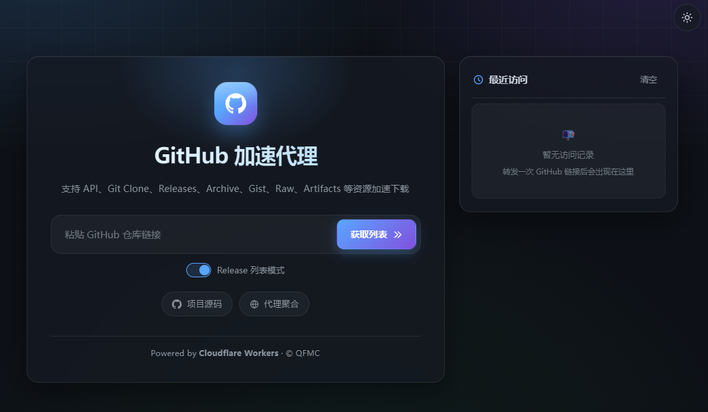

# CF-GH-Proxy
本项目是一个基于 Cloudflare Workers 的 Github 镜像代理工具。它能够中转 Github 项目请求，解决一些访问限制和加速访问的问题。

## 参考图(开关夜间模式）

## Release 列表模式

首页输入框下方有「Release 列表模式」开关（状态存在浏览器 localStorage，键名 `gh_proxy_release_mode`）。

- 开启后，按钮文字由 `Go` 变为 `获取列表`；输入 `github.com/owner/repo` 或 `owner/repo` 后提交，不再跳转，而是在浮窗里列出该仓库的 Release。
- 浮窗里每个 Release 显示 tag、标题、发布时间、作者、文件数量和已折叠的更新说明（超过 400 字可展开），以及各附件的大小；附件与 tag 链接都按本代理格式改写后再打开。每页 20 条，滚到底部可「加载更多」，翻页失败时保留已加载内容并给出「重试」。
- 数据来自本代理的 `/api.github.com/repos/<owner>/<repo>/releases`，因此同样受 `per_page`、`page` 与匿名额度限制；额度耗尽时浮窗内会提示 `x-ratelimit-reset` 对应的恢复时间。
- 关闭开关后按钮恢复 `Go`，行为与之前完全一致。
- 明确指向具体文件的链接不会被拦截，仍按原方式下载或预览：`releases/download/...`、`archive/...`、`blob/...`、`raw/...`、`info/...`、`git-...` 以及 `raw.githubusercontent.com`、`codeload.github.com`、`gist.githubusercontent.com` 的子路径，和以常见压缩包/安装包后缀结尾的链接。
- 无法识别为仓库的输入也不会进入浮窗，按原有逻辑跳转。

## Workers 部署方法
### 部署 Cloudflare Worker：

   - 在 Cloudflare Worker 控制台中创建一个新的 Worker。
   - 将 [worker.js](./worker.js) 的内容粘贴到 Worker 编辑器中。

### 配置 GITHUB_TOKEN（推荐）

不配置也能用，但所有访客共用 Cloudflare 的出口 IP，匿名额度只有 60 次/小时，很容易被别人用光。

1. 在 GitHub 的 Settings → Developer settings → Personal access tokens 里建一个 Token。**公开仓库的只读访问不需要勾选任何权限**（fine-grained token 不选 scope 即可读公开仓库）。
2. 在 Cloudflare 控制台打开这个 Worker → Settings → Variables and Secrets，添加变量 `GITHUB_TOKEN`，值填 Token，类型选 **Secret**（加密存储）。
3. 保存后立即生效，无需改代码。额度提升到 5000 次/小时。

取用顺序：调用方自己带 `Authorization` 就用调用方的，否则用 `GITHUB_TOKEN`。这个头只会发给 `api.github.com`，不会泄漏给 CDN 或其他目标。

## 缓存与限流

- `api.github.com` 的 JSON 响应不再写入边缘长缓存，始终回源并带 `Cache-Control: no-store`，避免拿到过期的 Star 数、Release 列表等数据。
- 保留目标 URL 的查询参数，Release 列表可通过 `per_page`、`page` 正常翻页。
- 其他 GitHub 静态资源仍按原策略缓存。
- 未配置 Token 时，GitHub 对同一出口 IP 的匿名 API 额度是 60 次/小时；在 Worker 里配置 `GITHUB_TOKEN` 后提升到 5000 次/小时，见上一节。
- 额度耗尽时 GitHub 返回 `403` 或 `429`，并附带 `x-ratelimit-remaining: 0` 与 `x-ratelimit-reset`（本代理原样透传）。页面只在 `x-ratelimit-remaining` 确实为 `0` 时提示「额度已用尽 + 恢复时间」；403 但仍有额度时，提示的是「仓库被禁用 / 触发二级限流 / 不允许匿名访问」这类真实原因，不再一律归咎于额度。
- 代理请求中，`Authorization` 头只会转发给 `api.github.com`；其他目标（包括 GitHub 的 CDN）会移除该头。调用方未带该头且 Worker 配置了 `GITHUB_TOKEN` 时，由 Worker 补上，调用方自带的 Token 优先级更高。
- 支持 `release-assets.githubusercontent.com`、`github-releases.githubusercontent.com` 等 GitHub Release 下载直链（它们此前不在允许列表里，粘贴直链会 404）。
- 限流只统计需要回源的请求：命中边缘缓存的请求不计入额度，因此单 IP 额度放宽为 30 秒 300 次。若需要更强的全局防护，建议在 Cloudflare 面板另配原生 Rate Limiting 规则（在边缘层拦截，不占用 Worker 执行时间，且计数全局共享）。
- 带 `Range` 的请求也会先查边缘缓存：若缓存里已有完整对象，直接从缓存切片返回 `206`，不再回源（响应头 `x-cache-status: HIT-RANGE`）。起点偏移超过 32 MB、单次切片超过 64 MB、缓存对象经过 gzip 压缩、或请求是多段 Range 时，仍走回源。把 `CONFIG.RANGE_CACHE_ENABLED` 设为 `false` 即可整体关闭该行为。`If-Range` 与缓存版本不匹配时按 RFC 返回完整 `200`。

# 致谢
[gh-proxy](https://github.com/hunshcn/gh-proxy)、[jsproxy](https://github.com/EtherDream/jsproxy/)、[CF-Workers-GitHub](https://github.com/cmliu/CF-Workers-GitHub/)、[CF-GitHub-Proxy](https://github.com/hubporg/CF-GitHub-Proxy)
